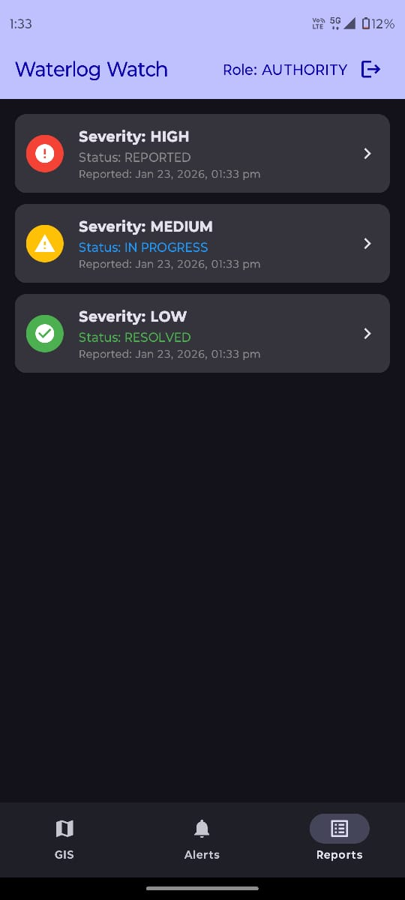
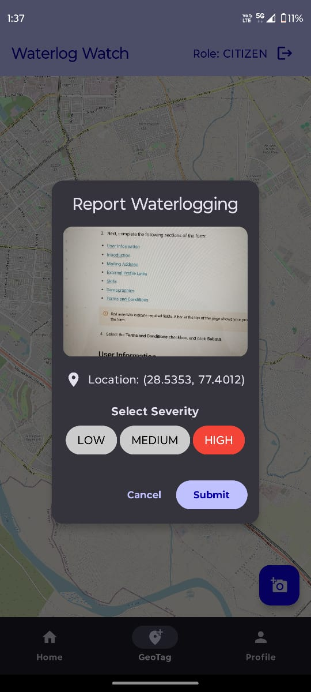
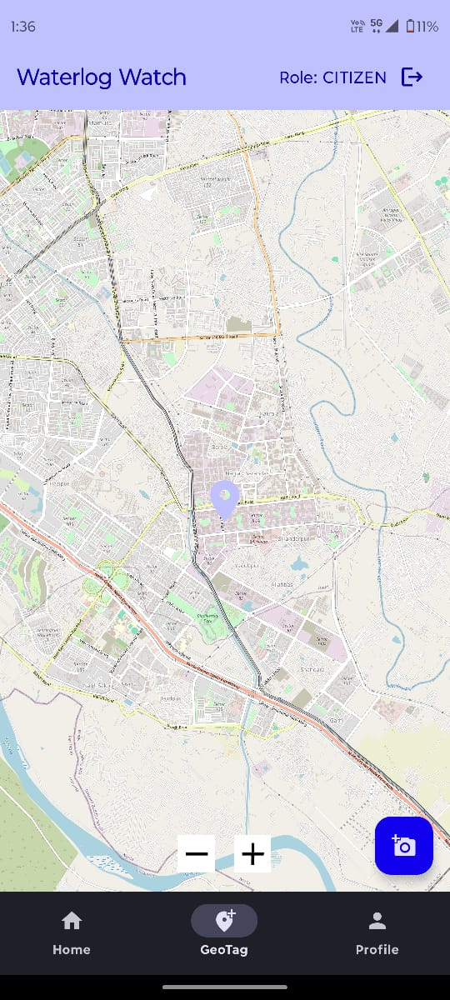
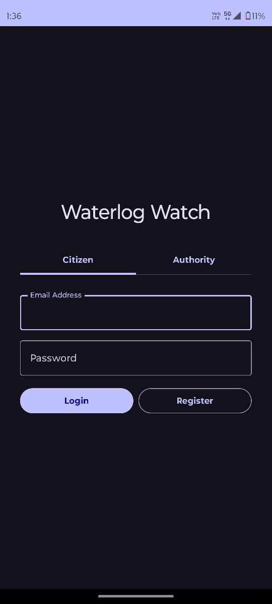

# 🌊 Flood Analyzer

> **CyberCup 5.0 Hackathon — Rapid Prototype**


**Flood Analyzer** is a disaster management tool developed during the **CyberCup 5.0 Hackathon**. It is designed to predict, visualize, and alert users about flood risks in real-time by bridging native mobile performance with predictive modeling.

---

## 📱 Key Features

- **⚡ Real-Time Alerts:** Instant push notifications for severe weather and flood warnings.
- **🗺️ Interactive GIS Mapping:** Built with **osmdroid** to visualize high-risk zones on OpenStreetMap.
- **🤖 Probability Estimation:** Python-based model that calculates flood risks based on incoming meteorological data.
- **☁️ Live Weather Data:** Seamless integration with the **OpenWeatherMap API**.
- **🏗️ Modern Architecture:** Built using **MVVM** and **Coroutines** for a robust, lag-free experience.

---

## 📸 Screenshots

<div align="center">
  <table>
    <tr>
      <td align="center">
        <br>
        <b>Dashboard</b>
      </td>
      <td align="center">
        <br>
        <b>Map View</b>
      </td>
      <td align="center">
        <br>
        <b>Alerts</b>
      </td>
    </tr>
    <tr>
     
      <td align="center">
        <br>
        <b>Details</b>
      </td>
    </tr>
  </table>
</div>

---

## 🛠️ Tech Stack

### Android Client (Mobile)
- **Language:** Kotlin
- **Architecture:** MVVM (Model-View-ViewModel)
- **Networking:** Retrofit
- **Mapping:** osmdroid
- **Concurrency:** Kotlin Coroutines

### Analysis Engine (Backend)
- **Language:** Python
- **Libraries:** Pandas, NumPy (for model logic)
- **Data Source:** OpenWeatherMap API

---

## 🚀 Getting Started

### Prerequisites
- Android Studio Iguana (or newer)
- Python 3.8+
- [OpenWeatherMap API Key](https://openweathermap.org/api)

### Installation

#### 1. Clone the Repository
```bash
git clone [https://github.com/YourUsername/flood-analyzer.git](https://github.com/YourUsername/flood-analyzer.git)
